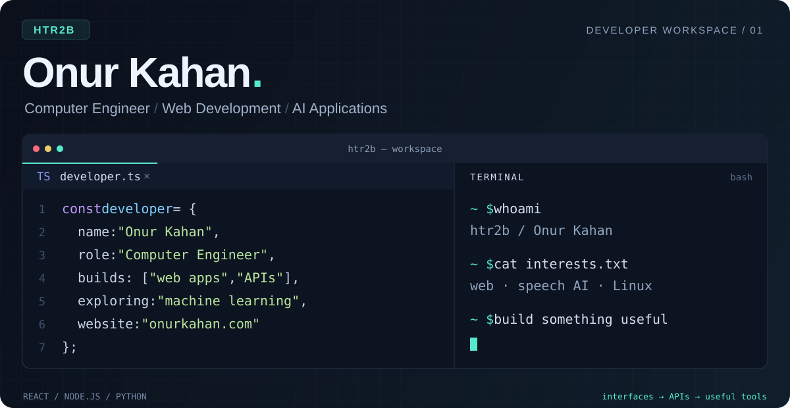

 

## Hey, I'm Onur.

I'm a computer engineer based in Türkiye. I build web applications, work with speech and language APIs, and write small tools that make everyday tasks easier.

I enjoy working across the stack: designing an interface, building the API behind it, and making the whole thing work together. I'm also developing my machine learning skills and exploring how to use models in practical applications.

## What I work on

- **Web applications** — React interfaces, Node.js APIs, authentication and data storage.
- **AI applications** — speech transcription, text summarization and API integrations.
- **Web quality** — usability, performance and technical SEO.
- **Practical tooling** — Python utilities and desktop automation.

## Selected projects

| Project | What it does | Built with |
| :--- | :--- | :--- |
| **EchoNote** · [Frontend](https://github.com/htr2b/speech-frontend) / [Backend](https://github.com/htr2b/speech-backend) | Record or upload audio, transcribe speech, and generate summaries. | React, Node.js, Express, Supabase, Google Cloud, Cohere |
| **[Linux Middle Click Autoscroll](https://github.com/htr2b/linux-middle-click-autoscroll)** | Adds middle-button autoscrolling to Linux X11, with speed based on pointer distance. | Python, pynput, xdotool |
| **[Personal Portfolio](https://github.com/htr2b/portfolio)** | A responsive portfolio with structured data, a sitemap and technical SEO setup. | HTML, CSS, JavaScript |

## Tools I use

---

Have a project in mind? Find me on <a href="https://www.linkedin.com/in/onurkahan/">LinkedIn</a> or visit <a href="https://onurkahan.com/">my portfolio</a>.

